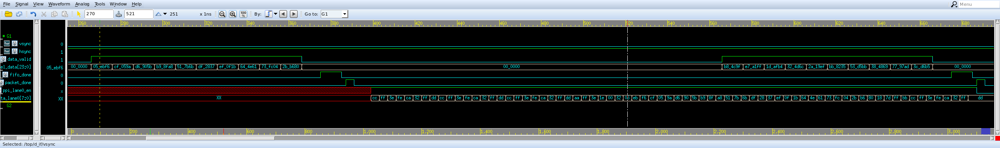
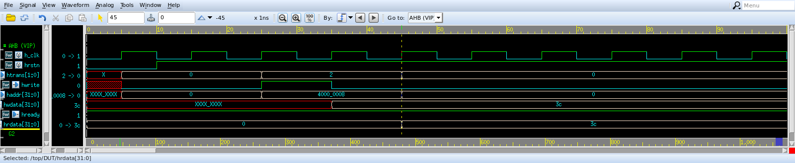
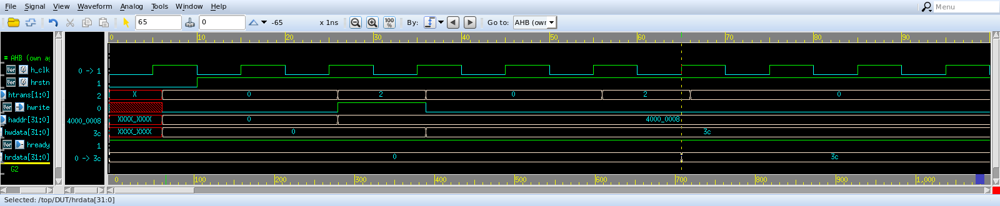
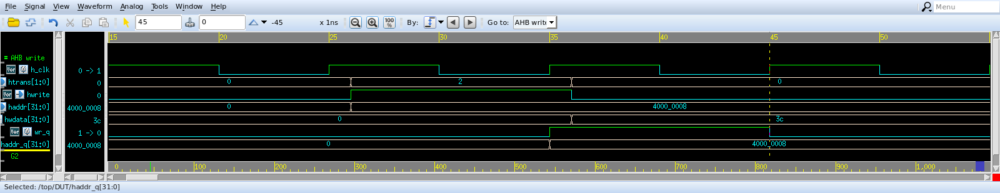
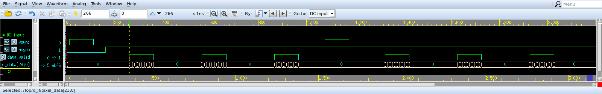
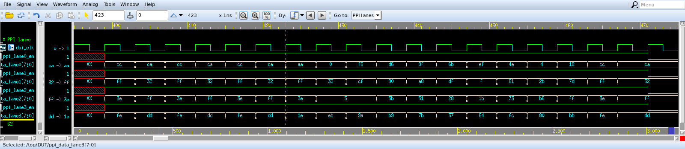
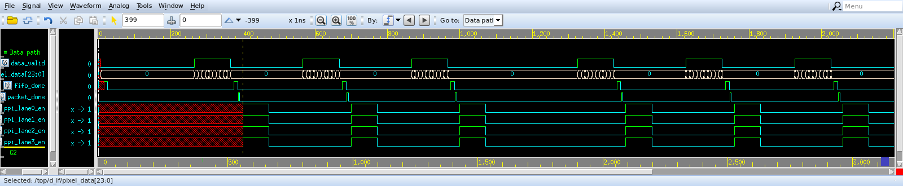

# MIPI-DSI

A MIPI DSI transmitter written in SystemVerilog, together with a UVM testbench that verifies it under Synopsys VCS.

The transmitter takes RGB888 pixels from a display controller (DC) interface, packs each line into a DSI long packet with header ECC and payload CRC, and sends it over 1 to 4 PPI data lanes. Configuration is done through an AHB register interface.

## Repository layout

```
RTL/                     transmitter
  design.sv              top level dsi #(FRAME_LENGTH, FRAME_DEPTH) and AHB register slave
  dsi_reg_block.sv       register model
  dsi_clk_gen.sv         dsi_clk generation (3x pclk)
  line_fifo.sv           buffers one line of pixels
  ecc_gen.sv             header ECC (DSI 9.3)
  crc_gen.sv             payload CRC-16, poly 0x1021, seed 0xFFFF (DSI 9.6)
  packetizer.sv          builds short and long packets
  lane_manager.sv        spreads the byte stream over 1-4 PPI lanes
VERIFY/
  bench/top.sv           testbench top, DUT instance, clocks and reset
  uvc/agent_top/         dc_agent (pixel source), ppi_agent (lane monitor), ahb_agent (AHB register sequences, plus an AHB master agent used with AHB=own)
  uvm_tb/                env, scoreboard and tests
  bin/                   Makefile and tool setup
```

## Data path

```
 DC (pixel_data, data_valid, hsync, vsync)
        |
    line_fifo --> ecc_gen / crc_gen --> packetizer --> lane_manager --> PPI lanes 0-3
                                                            ^
 AHB --> register block (dsi_cmd, dsi_lng, dsi_ctrl0 ...) --+
```

Each line goes out as three short packets, one long packet and a closing short packet.
The long packet is `AA FF | DI WC(2) ECC | payload (WC bytes) | CRC(2) FF BB`.

## Register map (base 0x4000_0000)

| Offset | Register | Use |
|---|---|---|
| 0x00 | payload | buffer register |
| 0x04 | dsi_cmd | `[8:1]` data identifier (0x3E = 24-bit packed pixel stream) |
| 0x08 | dsi_lng | `[16:1]` word count in bytes (3 x pixels per line) |
| 0x0C | dsi_ctrl0 | `[1:0]` active lanes minus one |
| 0x10 - 0x20 | dsi_ctrl1 - dsi_ctrl5 | control |
| 0x24 / 0x28 / 0x2C | rx_cmd_data / rx_cmd / rd_cmd_wc | receive side |
| 0x30 | rd_cmd_err | status, read only |

## Testbench

- `dc_agent` drives frames of random or fixed pixels with configurable VSYNC/HSYNC widths and resolution (NORMAL 10x3, VGA, HD, Full HD).
- `ppi_agent` samples the four lanes; the scoreboard rebuilds packets from the lane bytes, checks the framing bytes, recovers the pixels and compares them with what the DC side sent. Pixels left uncompared at the end of a test are reported as errors.
- The DSI registers are programmed over AHB, by either the Synopsys AHB VIP or the testbench's own AHB agent (see the next section).
- The register tests write a register, read it back and check that the value matches.
- Functional coverage: `dc_cg` and `ppi_cg` covergroups in the scoreboard. Assertion coverage through `-cm assert`.

## Choosing the AHB master: VIP or own agent

The testbench has two AHB masters. You pick one with `AHB=` on the `make` command line; the default is the VIP.

| | `AHB=vip` (default) | `AHB=own` |
|---|---|---|
| AHB master | Synopsys AMBA AHB VIP (`svt_ahb_system_env`) | `ahb_agent`: `ahb_driver`, `ahb_monitor`, `ahb_seqr` |
| Protocol checking | VIP built-in checkers | `ahb_monitor`: HRESP must be OKAY, HRDATA/HWDATA/HADDR must not be X/Z, word transfers must be aligned |
| Transfers | VIP issues them back to back | single NONSEQ word transfers, one idle cycle between them |
| Needs the Synopsys VIP | yes | no (VCS only) |

Everything else is shared: DUT, `dc_agent`, `ppi_agent`, scoreboard, coverage, sequences and all 27 tests. The sequences call `write_reg()` / `read_reg()` in `ahb_seqs.sv`, which issue a VIP or an `ahb_xtn` transaction depending on the build, and every test starts them on `e_h.ahb_sqr`.

```
cd VERIFY/bin
make regress SEED=1                     # VIP (default)
make regress SEED=1 AHB=vip             # VIP, stated explicitly
make regress SEED=1 AHB=own             # own AHB agent
make run UVM_TEST=lane_3_test AHB=own   # one test
make run_test25 AHB=own                 # numbered targets take it too
```

- The choice is made at compile time: `AHB=own` compiles with `+define+MIPI_OWN_AHB`, and only one master is built into `simv`.
- Switching is automatic. `make compile` records which master it built (`VERIFY/bin/.ahb_build`), and `make run` recompiles first if you ask for the other one.
- To see which master the current build uses: `make info` prints `AHB = vip` or `AHB = own`. In a test log, the UVM topology lists `ahb_agth` as `svt_ahb_system_env` (VIP) or `ahb_agent` (own).
- Any value other than `vip` or `own` stops with an error.

Files of the own agent, all in `VERIFY/uvc/agent_top/ahb_agent/`: `ahb_if.sv`, `ahb_xtn.sv`, `ahb_cfg.sv`, `ahb_seqr.sv`, `ahb_driver.sv`, `ahb_monitor.sv`, `ahb_agent.sv`. The register sequences shared by both masters are in `ahb_seqs.sv` in the same directory.

## Requirements and setup

The testbench needs licensed Synopsys tools. Nothing from them is included in this repository.

| Tool | Version used | Makefile variable |
|---|---|---|
| VCS (with UVM 1.2) | R-2020.12-SP2 | `VCS_HOME` |
| Verdi (waveforms, GUI) | R-2020.12-SP2 | `VERDI_HOME` |
| VC VIP, AMBA AHB (only for AHB=vip) | V-2023.12 | `DESIGNWARE_HOME`, `VIP_VERSION` |
| Licence server | | `SNPSLMD_LICENSE_FILE` |

With the default `AHB=vip` the testbench needs the Synopsys AMBA VIP. On the first `make compile` the Makefile runs `dw_vip_setup` from `$DESIGNWARE_HOME/bin` to generate the VIP model directory in `VERIFY/bin/vip/` (ignored by git).

With `AHB=own` the VIP is not used at all, so only VCS (and Verdi for waveforms) is needed.

The defaults point to `/tools/synopsys/...` and a licence server on port 27000 of the local host. If your install is elsewhere, set the variables in your environment or on the command line:

```
make compile VCS_HOME=/opt/synopsys/vcs/R-2020.12-SP2 \
             VERDI_HOME=/opt/synopsys/verdi/R-2020.12-SP2 \
             DESIGNWARE_HOME=/opt/synopsys/vip VIP_VERSION=V-2023.12 \
             SNPSLMD_LICENSE_FILE=27000@licserver
make info        # shows the paths that will be used
```

Other VCS and VIP versions should work but have not been tried.

## Running

```
cd VERIFY/bin
make compile                       # first run with AHB=vip also generates the VIP model dir (make vip)
make run UVM_TEST=lane_3_test SEED=1
make regress SEED=1                # all 27 tests, one log per test in logs/
make regress SEED=1 AHB=own        # same tests with the own AHB agent
make run UVM_TEST=lane_0_test GUI=1   # Verdi
make help                          # all targets and tests
```

| Option | Values | Default |
|---|---|---|
| `UVM_TEST` | test class name | `mipi_test` |
| `SEED` | `random` or a number | `random` |
| `AHB` | `vip` or `own` | `vip` |
| `GUI` | `1` opens Verdi | `0` |
| `DUMP` | `1` writes `mydump.fsdb` | `1` (`0` for the VGA/HD/Full HD tests) |
| `VERBOSITY` | UVM verbosity | `UVM_MEDIUM` (`UVM_LOW` for the VGA/HD/Full HD tests) |

Logs go to `VERIFY/bin/logs/<test>.log` and waveforms to `VERIFY/bin/mydump.fsdb` (overwritten by each run). Open a waveform with `verdi -ssf mydump.fsdb`.

The VGA, HD and Full HD tests move millions of pixels, so they run with per-pixel messages and the FSDB dump turned off. Use `VERBOSITY=UVM_MEDIUM DUMP=1` to turn them back on.

## Tests

| Group | Tests |
|---|---|
| Base | mipi_test |
| Lanes | lane_0_test ... lane_3_test (1 to 4 lanes) |
| Frames | dsi_frame5_test, frame_10_test |
| Sync | vsync_random_test, vsync_5_test, vsync_10_test |
| Pixels | pixel_random, white, black, red, green, blue, low, high |
| Resolution | resol_normal_test, resol_vga_test, resol_hd_test, resol_fullhd_test, resol_random_test |
| Registers | ahb_payloadreg_test, ahb_dsicmdreg_test, ahb_dsilngreg_test, ahb_ctrl0reg_test |

## Results

`make regress SEED=1` passes all 27 tests with no UVM errors with both AHB masters:

| AHB master | Pass | UVM_ERROR | UVM_FATAL |
|---|---|---|---|
| `AHB=vip` (Synopsys VIP) | 27 / 27 | 0 | 0 |
| `AHB=own` (own agent) | 27 / 27 | 0 | 0 |

The Full HD test compares 4,147,200 pixels (1920 x 1080, 2 frames). The logs and a per-test summary for both runs are in [`outputs/`](outputs/).

## Waveforms

Verdi nWave views of the `SEED=1` runs.

**One full line, DC input to PPI output** (`lane_0_test`, one lane, 255-695 ns). On the DC side (`pixel_data`) the line's 10 pixels go in: `05ebf6`, `cf059a`, `d6905b`, ..., `2bb680` (cursor on the first one). After `fifo_done` and `packet_done`, lane 0 (`ppi_data_lane0`) sends the line as three short packets `cc ff 3e fe ca 32 ff dd`, then the long packet `aa ff 3e 1e 00 32` (DI 0x3E, WC 30 bytes, ECC 0x32), the payload `05 eb f6 cf 05 9a d6 90 5b ... 2b b6 80` (marker on the first byte), CRC `18 7d`, trailer `ff bb`, and a closing short packet. The payload bytes are the same pixel values as the input, MSB first.



**AHB register write and read-back, Synopsys VIP** (`ahb_dsilngreg_test`, `AHB=vip`). The VIP writes `0x3c` to `dsi_lng` (0x4000_0008) and reads it straight back; the two transfers are back to back (HTRANS = NONSEQ from 25 to 45 ns) and HRDATA returns `0x3c` at the cursor.



**The same test with the own AHB agent** (`AHB=own`). The write (26-36 ns) and the read (56-66 ns) are separate single transfers with idle cycles between them; HRDATA returns `0x3c` at the cursor.



**Write in the AHB data phase.** The DUT samples HADDR and HWRITE in the address phase (`wr_q` and `haddr_q` go high at 35 ns) and writes HWDATA on the next edge, at the end of the data phase (45 ns, cursor).



**Pixel input from the DC side** (`lane_3_test`). Two frames, each starting with VSYNC, then three lines of 10 pixels (`data_valid` high).



**One line on four PPI lanes.** The transmission is spread byte by byte over lanes 0-3: three short packets (`cc ff 3e fe ca ..`), then the long packet starting at the cursor with `aa ff`, data identifier `3e`, word count `1e 00` (30 bytes), ECC `32`, followed by the payload.



**Line in, packet out.** Each line of pixels is followed by `fifo_done`, `packet_done` and a burst on all four lane enables.


